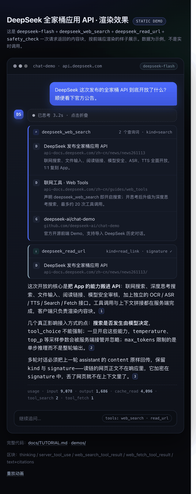

# DeepSeek Full-Suite App API · Tutorial & Demos

[中文](README.md) | **English**

On 2026-11-13 DeepSeek opened the full set of capabilities behind its official app as public APIs: web search, deep-thinking search, file input, URL reading, model content safety, conversation titles — plus standalone OCR, ASR, TTS, Search and Fetch endpoints. This repo takes each one apart into a runnable demo and documents the parts that behave differently from what you'd expect.

- 📖 Full tutorial (Chinese): [docs/TUTORIAL.md](docs/TUTORIAL.md)
- 🖥 Rendered demo page: [jimmywangjimmy.github.io/deepseek-app-api-tutorial](https://jimmywangjimmy.github.io/deepseek-app-api-tutorial/)
- 🧪 14 runnable scripts: [demos/](demos/)
- Official announcement: [api-docs.deepseek.com/news/news261113](https://api-docs.deepseek.com/news/news261113/)



## The mental model

These are **server-side tools**, not client-side function calling. You declare `deepseek_web_search` / `deepseek_read_url` in `tools`; the service runs the search, fetches pages, assembles context, and returns content blocks. Your client only renders them:

```
thinking · server_tool_use · web_search_tool_result ·
web_fetch_tool_result · text + citations
```

The same capabilities work across `Messages` (`/anthropic/v1/messages`), `Responses` (`/responses`) and `Chat Completions` (`/chat/completions`) with `deepseek-flash`.

## Gotchas worth knowing

| Trap | What actually happens |
|---|---|
| Sampling params are taken over | Declaring the web tools, `safety_check: high` or `title` makes the server ignore `temperature`, `top_p`, `seed`, `stop`, … |
| `max_tokens` means something else | It caps one inference step, not the whole round |
| Page text is not in the response | `read_link` keeps the page in an encrypted `signature`; pass the block back verbatim across turns or the page drops out of context |
| You cannot force a search | `tool_choice` rejects the built-in tool names; `"none"` disables URL reading too |
| HTTP 200 can still be a failure | Mid-generation errors arrive in the body, and search/fetch done before the failure is still billed |
| Chinese TTS bills double | A CJK character counts as 2 billable characters |

## Quick start

```bash
git clone https://github.com/JimmyWangJimmy/deepseek-app-api-tutorial.git
cd deepseek-app-api-tutorial

python3 -m pip install -r demos/requirements.txt
export DEEPSEEK_API_KEY=sk-...

cd demos
python3 01_web_search.py --dry-run   # no key needed: prints the request, sends nothing
python3 01_web_search.py             # real call (billed per request)
python3 12_full_chatbot.py           # interactive full chatbot
```

Every script supports `--dry-run` and `--show-thinking`.

## Demos

| # | Script | Capability |
|---|---|---|
| 01 | [web_search](demos/01_web_search.py) | Web search, thinking off |
| 02 | [deep_thinking_search](demos/02_deep_thinking_search.py) | Search inside multi-step reasoning |
| 03 | [read_url](demos/03_read_url.py) | Read links in the user message |
| 04 | [file_input](demos/04_file_input.py) | Upload + reference documents |
| 05 | [safety_check](demos/05_safety_check.py) | Model content safety / refusals |
| 06 | [title](demos/06_title.py) | Conversation titles |
| 07 | [latest_reminder](demos/07_latest_reminder.py) | Date / location / language marker |
| 08 | [search_fetch](demos/08_search_fetch.py) | Standalone Search & Fetch APIs |
| 09 | [ocr](demos/09_ocr.py) | OCR with layout boxes |
| 10 | [tts](demos/10_tts.py) | TTS, whole + WebSocket streaming |
| 11 | [asr](demos/11_asr.py) | Speech to text |
| 12 | [full_chatbot](demos/12_full_chatbot.py) | Everything wired together |
| 13 | [chat_completions](demos/13_chat_completions.py) | Chat Completions flavour |
| 14 | [responses_api](demos/14_responses_api.py) | Responses flavour |

## Layout

```
├── docs/TUTORIAL.md    # 19-chapter tutorial (Chinese)
├── docs/preview.png    # rendered effect preview
├── demos/              # 14 scripts + common.py
├── examples/           # captured --dry-run output
└── site/index.html     # static renderer demo (GitHub Pages)
```

## Billing

Beyond tokens these capabilities bill per call / page / second: search & fetch ¥5 per 1,000 calls, OCR ¥1.5 per 1,000 pages, ASR ¥0.39 per hour, TTS ¥1.5 per 10,000 characters (limited-time 50% off). Use `--dry-run` first.

## License

[MIT](LICENSE) © 2026 Jiaming Wang

Third-party tutorial, not affiliated with DeepSeek. Behaviour follows the [official docs](https://api-docs.deepseek.com/).
