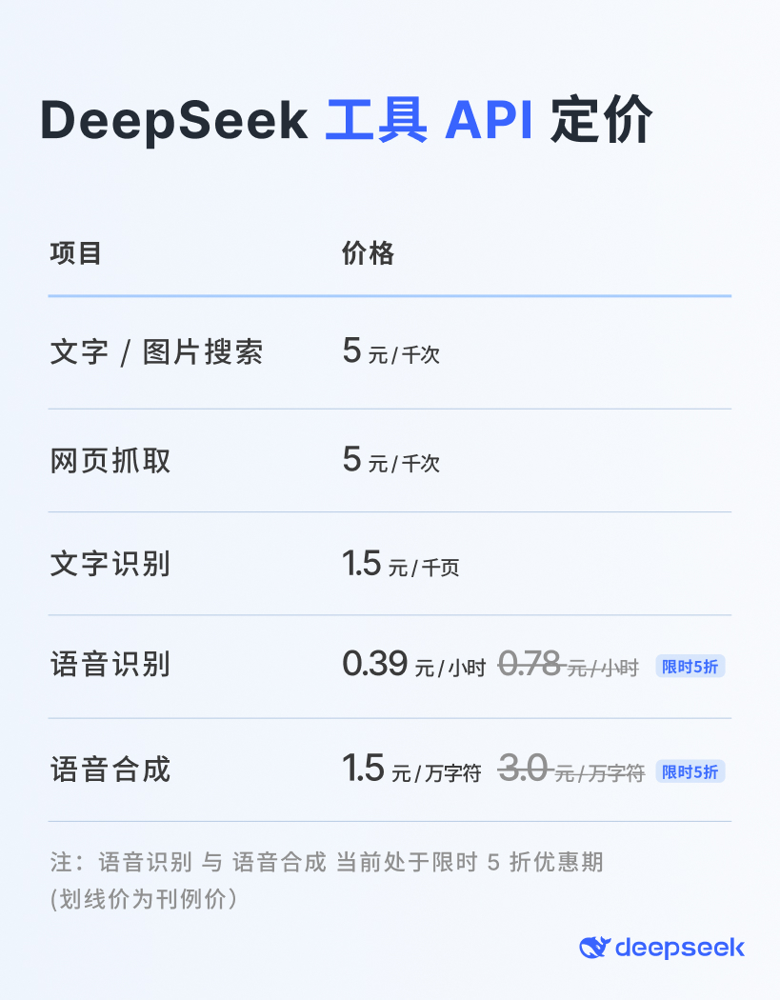

# DeepSeek 全家桶应用 API 上手教程

> 对应发布：[DeepSeek 发布全家桶应用 API（2026/11/13）](https://api-docs.deepseek.com/zh-cn/news/news261113/)
> 官方指南：[Build a Chatbot](https://api-docs.deepseek.com/zh-cn/guides/build_a_chatbot) · [联网工具](https://api-docs.deepseek.com/zh-cn/guides/web_tools) · [文件解析](https://api-docs.deepseek.com/zh-cn/guides/document_parsing) · [模型内容安全](https://api-docs.deepseek.com/zh-cn/guides/safety) · [Search/Fetch](https://api-docs.deepseek.com/zh-cn/guides/search) · [OCR](https://api-docs.deepseek.com/zh-cn/guides/ocr) · [TTS](https://api-docs.deepseek.com/zh-cn/guides/tts) · [ASR](https://api-docs.deepseek.com/zh-cn/guides/asr)
> 本教程里每个能力都有一个可直接跑的脚本，位于 `demos/`。

---

## 0. 先建立心智模型

这次开放的 5 个能力（搜索、深度思考搜索、文件输入、读链、安全审核）**都不是客户端工具**，而是服务端工具：你在请求里声明开关，搜索解析、抓页、上下文拼接全部由 DeepSeek 服务端完成，你的客户端只负责**渲染返回的内容块**。这和过去的 function calling 完全不同——你不再实现一个 `search()` 函数，也不再自己把检索结果塞进 prompt。

剩下的 OCR / ASR / TTS / Search / Fetch 是**独立 HTTP 接口**，不经过对话模型，可以单独接进自己的流水线。

```
对话链路（服务端托管）        独立工具链路（你直接调）
┌──────────────┐            ┌──────────────────┐
│ 你的请求      │            │ /v1/tools/search │
│ + tools 声明  │            │ /v1/tools/fetch  │
│ + safety/title│            │ /v1/tools/ocr    │
└──────┬───────┘            │ /v1/tools/asr    │
       ▼                    │ /v1/tools/tts    │
┌──────────────┐            └──────────────────┘
│ 模型 + 工具   │
│ 服务端执行    │
└──────┬───────┘
       ▼
┌──────────────────────────────┐
│ thinking / server_tool_use    │
│ web_search_tool_result        │
│ web_fetch_tool_result         │
│ text + citations              │
└──────────────────────────────┘
```

三个协议都能用这些能力，字段略有差异：

| 协议 | 端点 | 鉴权头 | 思考开关 | 工具声明 |
|---|---|---|---|---|
| Messages（Anthropic 兼容） | `POST /anthropic/v1/messages` | `x-api-key` | `"thinking": {"type": "enabled"}` | `{"type": "deepseek_web_search", "name": "deepseek_web_search"}`（要 `name`） |
| Responses | `POST /responses` | `Authorization: Bearer` | `"reasoning": {"effort": "high"}` | `{"type": "deepseek_web_search"}` |
| Chat Completions | `POST /chat/completions` | `Authorization: Bearer` | `"thinking": {"type": "enabled"}` | `{"type": "deepseek_web_search"}` |

模型固定用 `deepseek-flash`（V4.1-Flash）。

---

## 1. 环境准备

```bash
cd docs/deepseek-app-api-tutorial/demos
python3 -m pip install -r requirements.txt
export DEEPSEEK_API_KEY=sk-...
```

每个脚本都支持 `--dry-run`：只打印将要发出的 URL、脱敏后的请求头和完整请求体，不发请求、不花钱。强烈建议先 dry-run 一遍再真跑。

```bash
python3 01_web_search.py --dry-run
```

`common.py` 里封装了三个协议的请求、SSE 解析和流式打印，读教程时可以对照它。

### 1.5 同一件事，三种协议的写法

后面章节都用 Messages 协议讲解（它的 block 结构最直观），另外两个协议的完整可跑脚本在这里：

- [`demos/13_chat_completions.py`](../demos/13_chat_completions.py)：Chat Completions + `server_tool_calls` / `annotations` / `server_tool_event`
- [`demos/14_responses_api.py`](../demos/14_responses_api.py)：Responses + `web_search_call` item / `output_text` 注解 / `response.*` 事件

差异速查：

| | Messages | Responses | Chat Completions |
|---|---|---|---|
| 工具声明 | `{"type": "...", "name": "..."}` | `{"type": "..."}` | `{"type": "..."}` |
| 思考 | `thinking.type=enabled` | `reasoning.effort=high` | `thinking.type=enabled` |
| 工具调用位置 | `content[]` 里的 `server_tool_use` + 结果块 | `output[]` 里的 `web_search_call` item | `message.server_tool_calls[]`（分步） |
| 引用 | `text.citations[]` | `output_text` 的 `url_citation` 注解 | `message.annotations[]` |
| 拒答 | `stop_reason=refusal` | `status=incomplete` + `content_filter` | `finish_reason=content_filter` |
| 流式工具事件 | `content_block_start` 一次性给整块 | `response.output_item.added/done`、`response.web_search_call.*` | `choice.server_tool_event` |
| 续写（prefix） | 支持 | 不支持 | 仅 `/beta/chat/completions` + `prefix: true` |
| `latest_reminder` | 支持 | **不支持** | 支持 |
| `tool_choice: required` | — | 按 `auto` 处理 | 按 `auto` 处理 |

---

## 2. 联网搜索（关闭思考）

**开关**：只声明 `deepseek_web_search`，不开启思考。
**行为**：模型自己判断要不要搜、搜什么，一次调用可含多个查询词，回答带引用。

```python
payload = {
    "model": "deepseek-flash",
    "tools": [{"type": "deepseek_web_search", "name": "deepseek_web_search"}],
    "messages": [{"role": "user", "content": "DeepSeek V4.1 是什么时候发布的？有哪些新能力？"}],
}
```

```bash
python3 01_web_search.py            # → demos/01_web_search.py
```

脚本：[`demos/01_web_search.py`](../demos/01_web_search.py)
流出来的东西长这样：

```
[start] usage={"input_tokens": 40, ...}
[tool] deepseek_web_search kind=search input={"action": "search", "queries": ["DeepSeek V4.1 发布", "..."]}
  · [DeepSeek] DeepSeek-V4.1-Flash 发布  https://api-docs.deepseek.com/...
[thinking] ...
[answer] DeepSeek V4.1-Flash 于 2026 年 9 月 10 日发布……
  [cite] DeepSeek-V4.1-Flash 发布 https://api-docs.deepseek.com/...
[end] stop_reason=end_turn title=None
usage: {"input_tokens": 9078, "output_tokens": 1686, "server_tool_use": {"tool_search": 2, ...}}
```

要读的字段：

| 字段 | 含义 |
|---|---|
| `server_tool_use.input.queries` | 这次调用的搜索词，**计费按查询词条数算**（3 个词计 3 次） |
| `web_search_tool_result.content[]` | 结果列表，展示用 `title` / `url` / `site_name` / `site_icon` / `page_age` |
| `text.citations[]` | 引用，`type` 恒为 `web_search_result_location`，`cited_text` 是回答文本片段而不是原文摘录 |
| `usage.server_tool_use.tool_search` | **真正计费的搜索次数**；`web_search_requests` 只是块数量，别拿来算钱 |

想关搜索？不声明 `deepseek_web_search` 就行。`tool_choice` 不能强制指定它（会 `400`），`tool_choice: "none"` 会把读链一起关掉。

---

## 3. 深度思考搜索（开启思考）

**同一个工具，多开一个 `thinking`**，行为从“搜一次答一句”变成“边推理边检索”：`search → open_page → find_in_page` 循环，最多约 20 次工具调用。

```python
payload = {
    "model": "deepseek-flash",
    "thinking": {"type": "enabled"},
    "tools": [{"type": "deepseek_web_search", "name": "deepseek_web_search"}],
    "messages": [{"role": "user", "content": "埃菲尔铁塔和东京塔哪个更高？请查两边的官方网站确认。"}],
}
```

```bash
python3 02_deep_thinking_search.py --show-thinking
```

脚本：[`demos/02_deep_thinking_search.py`](../demos/02_deep_thinking_search.py)

典型块序列（官方示例的问题）：

```
thinking
server_tool_use  search        4 queries
web_search_tool_result
thinking
server_tool_use  open_page     https://www.toureiffel.paris/en/the-monument/key-figures
server_tool_use  open_page     https://en.tokyotower.co.jp/company/
web_fetch_tool_result ×2
thinking
server_tool_use  find_in_page  pattern "333"
web_fetch_tool_result
thinking
text  (带 citations)
```

三个 `action` 的区别：

| `action` | 属于 | 计费 |
|---|---|---|
| `search` | `deepseek_web_search` | 按查询词条数 |
| `open_page` | `deepseek_web_search`（模型自己搜到的页） | 只在真正从网络抓取时计费；重复打开、翻页、内容已在搜索结果里都不计费 |
| `find_in_page` | `deepseek_web_search` | 不计费 |

注意：深度思考搜索里 `open_page` 返回的网页**只有 URL、标题、发布时间**，`data` 恒为空字符串，**也没有 `signature`**——所以它不会被拼回下一轮上下文。这是它和“阅读链接”最大的区别。

---

## 4. 阅读链接

**开关**：声明 `deepseek_read_url`。模型读取**最后一条用户消息**里的 URL，去重后最多看前 10 个。

```python
payload = {
    "model": "deepseek-flash",
    "tools": [{"type": "deepseek_read_url", "name": "deepseek_read_url"}],
    "messages": [{"role": "user", "content": "总结这个链接：https://api-docs.deepseek.com/zh-cn/news/news261113/"}],
}
```

```bash
python3 03_read_url.py https://example.com/a https://example.com/b
```

脚本：[`demos/03_read_url.py`](../demos/03_read_url.py)

返回的 `web_fetch_tool_result` 里：

```json
{
  "type": "web_fetch_tool_result",
  "tool_use_id": "srvtoolu_rl_01_...",
  "content": {
    "type": "web_fetch_result",
    "url": "https://example.com/a",
    "content": {"type": "document", "source": {"type": "text", "media_type": "text/plain", "data": ""}, "title": "页面标题"},
    "published_at": "2026-01-01"
  },
  "kind": "read_link",
  "signature": "q3J0b1RmZ1c4cE1x..."
}
```

**正文不在响应里**，它被加密放进 `signature`。所以：

- 前端拿不到正文，别指望在浏览器里做摘要；
- 多轮时把整个块**原样回传**，服务端才会把网页拼回上下文；
- 改 `url` / `title` / `data` / `published_at` 不影响结果（仅供展示），但**丢了 `signature` 网页就没了**；
- 同一轮读多个链接，单页可用长度会被压缩，长页会被截断；
- 开了 `safety_check` 的 `high` 后，页面要先过审，未通过的返回 `url_not_allowed`。

一个容易踩的组合：**开思考 + 声明了 `deepseek_web_search` 时，`deepseek_read_url` 不单独工作**，本轮走深度思考搜索。想让读链生效，就关思考，或者只声明 `deepseek_read_url`。

---

## 5. 文件输入（PDF / Office / 图片）

两步：先上传解析拿 `file_id`，再在对话里引用。

```bash
# 1) 上传：purpose 必须在 file 之前
curl https://api.deepseek.com/files \
  -H "Authorization: Bearer $DEEPSEEK_API_KEY" \
  -F purpose="rich_layout_recognition" \
  -F file="@report.pdf"

# 2) 引用
curl https://api.deepseek.com/anthropic/v1/messages \
  -H "Content-Type: application/json" \
  -H "x-api-key: $DEEPSEEK_API_KEY" \
  -H "anthropic-beta: files-api-2025-04-14" \
  -d '{
    "model": "deepseek-flash",
    "messages": [{"role": "user", "content": [
      {"type": "document", "source": {"type": "file", "file_id": "file-api-xxxx"}},
      {"type": "text", "text": "总结要点。"}
    ]}]
  }'
```

```bash
python3 04_file_input.py ~/Downloads/report.pdf
```

脚本：[`demos/04_file_input.py`](../demos/04_file_input.py)

两种 `purpose` 决定模型**能不能看到文档里的图**：

| `purpose` | 模型拿到什么 | 场景 |
|---|---|---|
| `text_recognition` | 只有文字，图表/照片被丢弃 | 合同、论文、扫描件 |
| `rich_layout_recognition` | 文字 + 按原位置裁出的图片，图占输入 Token | 带图表的财报、PPT、说明书 |
| `user_data` | 纯文本/表格/电子书直接转文本，**不计费** | txt / md / csv / json / 代码 / xlsx / epub |

限制清单（都会返回明确状态码）：

- 文件 ≤ 100 MiB、≤ 1000 页；上传 120 秒内完成（`408`），解析 120 秒内完成（`504`）
- 每个请求最多引用 20 个文档、文档文字合计 ≤ 8 MiB
- 原始文件与解析结果**都不支持下载**
- 密码文件、格式不支持 → `400`；账号同时上传数上限 15 → `429`
- Messages 引用文档必须带 `anthropic-beta: files-api-2025-04-14`

计费：上传解析时按页一次性收（1.5 元/千页），对话引用时只收输入 Token。

---

## 6. 图片搜索（隐含能力）

不用额外开关：**消息里带图片 + 声明 `deepseek_web_search`**，模型就可能按图搜索。

和普通搜索的区别只有三点：

- `kind` 是 `image_search`，深度思考搜索中是 `deep_image_search`
- `queries` 为空数组
- 每条结果多一个 `image_url`（原站图片地址，仅供展示，可能不存在或打不开）

计费：每张图 1 次；模型框选图中区域时每个区域再加 1 次；搜不到不计费。Search API 目前**不支持**图片搜索，图片搜索只能走联网工具。

---

## 7. 模型内容安全

```python
payload = {
    "model": "deepseek-flash",
    "safety_check": {"level": "high"},
    "messages": [{"role": "user", "content": "..."}],
}
```

```bash
python3 05_safety_check.py
```

脚本：[`demos/05_safety_check.py`](../demos/05_safety_check.py)

`level` 只有两个值：`high`（开基础风控）、`low`（等于不传，API 默认检查）。

拒答在三个协议里的表现：

| 协议 | 拒答标识 |
|---|---|
| Messages | `stop_reason: "refusal"`，`stop_details: {"type":"refusal","category":null,"explanation":null}` |
| Responses | `status: "incomplete"`，`incomplete_details.reason: "content_filter"` |
| Chat Completions | `finish_reason: "content_filter"`，`content` 为空字符串，`annotations` 不返回 |

处理要点：

- 开 `safety_check` 后，输出结束**连接不会立刻关闭**——服务端还要对完整输出再审一次，所以拒答可能在你已经流式打印完之后才到；
- **已经下发的文本撤不回来**，前端要整段替换成自己的兜底文案；
- 被拒答时思考和回答文本会被清空，`content` 里保留已执行的工具块 + 一个空 `text` 块（流式时如果之前没发过 text 块，会补发一个空的，避免 SDK 取文本报错）；
- 图片被拦会明确指出位置，如 `The following images were blocked by content moderation: messages.1.content.0`；
- 审核 Token 按输出 Token 计费，单独列在 `usage.output_tokens_details.safety_tokens`（Chat Completions 是 `completion_tokens_details.safety_tokens`）；
- 输入命中审核 → HTTP `400 Content Exists Risk`，输入 Token 仍按缓存命中价计费；
- 没开 `safety_check` 但声明了联网工具的请求，也可能被拒答。

---

## 8. 会话标题

```python
"title": {"enabled": True}
```

```bash
python3 06_title.py
```

脚本：[`demos/06_title.py`](../demos/06_title.py)

| 协议 | 非流式 | 流式 |
|---|---|---|
| Messages | 顶层 `title` | `message_delta.delta.title` |
| Responses | 顶层 `title` | 结束事件里的 `response.title` |
| Chat Completions | `message.title` | 最后一个 chunk 的 `delta.title` |

三个实操建议：只在会话**第一条**请求开启；回答结束后最多等标题 5 秒，别把它当稳定字段；拒答或出错时可能没有标题，兜底取用户消息前 N 个字符。标题不计费。

---

## 9. 用户元信息标记（latest_reminder）

DeepSeek 网页端会把“今天几号、用户在哪、用什么平台和语言”告诉模型。走 API 时由你注入：

```
格式：<date>,<weekday>,<location>,<platform>,<language>
示例：2026-11-14,星期六,上海,Web,中文
```

```python
messages = [
    {"role": "latest_reminder", "content": "2026-11-14,星期六,上海,Web,中文"},
    {"role": "user", "content": "今天是几号？"},
]
```

```bash
python3 07_latest_reminder.py
```

脚本：[`demos/07_latest_reminder.py`](../demos/07_latest_reminder.py)

规则很硬，违反就 `400`：

- `content` 必须是字符串（否则 `422` 解析失败）
- 后面**必须紧跟一条 `user` 消息**
- 不能插在 `tool_use` 和 `tool_result` 之间
- 只在 Messages 与 Chat Completions 支持，**Responses 不支持**
- 消息里的链接不会被阅读，也不影响是否触发搜索
- 每轮一条、随历史回传能提高上下文缓存命中率

---

## 10. 独立 Search / Fetch

不进对话模型、直接拿结构化网页数据，适合自建 RAG 或 Agent。

```bash
# 搜索
curl https://api.deepseek.com/v1/tools/search \
  -H "Authorization: Bearer $DEEPSEEK_API_KEY" \
  -H "Content-Type: application/json" \
  -d '{"query": "DeepSeek 全家桶 API site:github.com lang:zh after:2026", "count": 5, "need_content": false}'

# 抓页
curl https://api.deepseek.com/v1/tools/fetch \
  -H "Authorization: Bearer $DEEPSEEK_API_KEY" \
  -H "Content-Type: application/json" \
  -d '{"url": "https://example.com/article"}'
```

```bash
python3 08_search_fetch.py
```

脚本：[`demos/08_search_fetch.py`](../demos/08_search_fetch.py)

Search 请求字段：

| 字段 | 说明 |
|---|---|
| `query` | 1～128 字符，支持搜索语法 |
| `count` | 1～50，默认 10，只影响返回条数不影响价格 |
| `ori_question` | 触发搜索的用户原始问题，帮引擎理解意图 |
| `localization` | 用于优先返回本地结果的 IP |
| `need_content` | `true` 才返回网页正文，`false` 时 `content` 恒为空 |

搜索语法可以组合：`site:` / `-site:` / `-词` / `-"短语"` / `"精确短语"` / `lang:zh,en` / `after:2025-01-01` / `before:2026`。

结果字段里最有用的是两个质量分：

- `rerank_score` 0～3，**≥1.5 算优质**
- `authority` 0～4，**≥3 算极权威**，`-1` 未知

`snippet`（100~200 字，给前端展示）与 `summary`（600~800 字，给模型读）内容不同，别混用。

Fetch 返回 `{title, content}`，`content` 是 Markdown。限制：URL ≤ 8192 字符、必须 http/https、不能带账号密码。错误语义要分清：`403` 被安全策略拒绝、`404` 拿不到可用内容、`408/429/5xx` 可重试、`402` 先充值。

计费与限速：两者都按**成功请求次数**计，5 元/千次；Search 100 QPS、Fetch 25 QPS（账号级，与模型并发无关，Fetch 还有按目标域名的限速）。

---

## 11. OCR

```bash
curl https://api.deepseek.com/v1/tools/ocr \
  -H "Authorization: Bearer $DEEPSEEK_API_KEY" \
  -F purpose="rich_layout_recognition" \
  -F file="@document.pdf"
```

```bash
python3 09_ocr.py ~/Downloads/document.pdf
```

脚本：[`demos/09_ocr.py`](../demos/09_ocr.py)

要点：

- 只有 `file` 和 `purpose` 两个字段，多传字段直接 `400`
- 文件不存 Files API、不交给对话模型，纯识别
- 响应体前面会有一堆换行（保活），**整个响应体可以直接按 JSON 解析**
- `pages[].text` 是模型原始输出，带 `<|ref|>…<|/ref|>` 和 `<|box|>[[x1,y1,x2,y2]]<|/box|>` 标记
- 坐标归一化到 0–1000，原点左上角；实际像素 `x * 页面宽度 / 1000`
- `finish_reason: "length"` 表示该页被截断
- 限制：≤ 100 MiB、≤ 1000 页、上传 120 秒（停顿 ≤ 30 秒）、总时长 180 秒；并发 15
- 计费 1.5 元/千页，按 `page_count` 算；**客户端断开不会取消识别**，跑完照常计费

---

## 12. TTS

整段合成（JSON，音频在响应体里流式返回）：

```bash
curl https://api.deepseek.com/v1/tools/tts \
  -H "Authorization: Bearer $DEEPSEEK_API_KEY" \
  -H "Content-Type: application/json" \
  -d '{"text": "你好，我是 DeepSeek。", "voice_id": "stella"}' \
  --output speech.wav
```

流式合成（边生成边发文字，边收音频帧）：

```python
url = "wss://api.deepseek.com/v1/tools/tts?voice_id=stella&format=pcm"
async with websockets.connect(url, additional_headers={"Authorization": f"Bearer {key}"}) as ws:
    await ws.send(json.dumps({"event": "text", "text": "Hello "}))
    await ws.send(json.dumps({"event": "finish_text"}))
    async for message in ws:   # 二进制 = 音频帧，文本 = 结束事件
        ...
```

```bash
python3 10_tts.py          # 整段 → speech.wav
python3 10_tts.py --ws     # 流式 → speech.pcm（需 pip install "websockets>=14"）
```

脚本：[`demos/10_tts.py`](../demos/10_tts.py)

参数：`voice_id` 只有 `stella`（女声，默认）和 `tide`（男声）；`format` 整段支持 `wav`/`pcm`，WS 支持 `pcm`/`opus`；`filter_markdown` 默认 `true`，朗读前去掉 Markdown。没有语种参数，语种自动识别（支持 10 种，含粤语）。

限制：单次最多 10,000 计费字符、请求体 64 KiB、音频最长 30 分钟；WS 会话 60 秒没收到文字就断，服务端每 25 秒 ping；不支持调速、不支持断点续传。

计费：1.5 元/万字符（限时 5 折，刊例 3 元）。**汉字算 2 个字符**，字母数字空格算 1 个——中文成本大约是英文的两倍。

---

## 13. ASR

```bash
curl https://api.deepseek.com/v1/tools/asr \
  -H "Authorization: Bearer $DEEPSEEK_API_KEY" \
  -F file="@speech.wav"
```

```bash
python3 11_asr.py speech.wav
```

脚本：[`demos/11_asr.py`](../demos/11_asr.py)

返回 `{request_id, text, duration_ms}`。硬性要求：16 位 PCM WAV 或 Ogg Opus、采样率 8000/16000/22050/24000/32000/44100/48000、单或双声道（**双声道只识别左声道**）、≤ 8 MiB、≤ 120 秒、上传 10 分钟内完成。语种自动识别（21 种）。计费 0.39 元/小时（限时 5 折），按秒计、不足 1 秒按 1 秒。

---

## 14. 拼一个完整 Chatbot

```bash
python3 12_full_chatbot.py                    # 交互模式
python3 12_full_chatbot.py "今天上海的天气" --tts
```

脚本：[`demos/12_full_chatbot.py`](../demos/12_full_chatbot.py)

它做的事就是官方 App 的最小骨架：

1. 每轮请求前插一条 `latest_reminder`
2. 声明 `deepseek_web_search` + `deepseek_read_url`
3. 开 `safety_check: high`，第一轮额外开 `title`
4. 流式/非流式渲染 `thinking` / `server_tool_use` / search 结果 / fetch 结果 / 带引用的 text
5. 把 assistant 的 `content` **原样**塞回 history
6. 可选：把回答丢给 TTS 朗读

前端的 block → UI 映射：

| block | 渲染成什么 |
|---|---|
| `thinking` | 可折叠的思考面板 |
| `server_tool_use` + `web_search_tool_result` | 搜索步骤 + 结果卡片（标题、站点名、图标） |
| `server_tool_use` + `web_fetch_tool_result` | “正在阅读 / 已打开”的页面条目 |
| 带 `citations` 的 `text` | 正文 + 引用角标，点开跳源 |
| `stop_reason: "refusal"` | 整段替换为你的拒答文案 |

---

## 15. 多轮对话：最容易错的地方

规则只有一句：**每一轮都把之前的 assistant 回复原样回传，保留 `kind` 和 `signature`。**

- 搜索结果、打开的网页、之前轮次的思考**都不进入后续上下文**，只保留回答正文
- 读链得到的网页靠 `signature` 还原，拼到**那一轮用户消息末尾**；`signature` 丢了网页就丢了，但请求仍然成功
- 带联网工具块的历史，也可以发给没声明这些工具的请求
- Chat Completions 里 `server_tool_calls` 若被框架/网关丢掉，请求照常跑，但之前读过的网页不再进上下文——这是最隐蔽的坑
- 同一条 assistant 消息不能续写（用过联网工具时返回 `400`），只能重发上一次请求

Chat Completions 的 assistant 结构长这样（协议间字段名不同，语义一致）：

```json
{
  "role": "assistant",
  "content": "这篇文章主要讲……",
  "annotations": [{"type": "url_citation", "url_citation": {"url": "...", "title": "...", "start_index": 0, "end_index": 10}}],
  "server_tool_calls": [
    {"index": 0, "reasoning_content": "", "calls": [
      {"index": 0, "id": "srvtoolu_rl_00_...", "type": "deepseek_read_url", "kind": "read_link",
       "action": {"type": "read_link", "url": "https://example.com/post"}, "status": "completed",
       "page": {"url": "...", "title": "...", "published_at": "2026-01-02"},
       "signature": "q3J0b1RmZ1c4cE1x..."}
    ]}
  ]
}
```

---

## 16. 参数被接管：为什么你的 temperature 不生效

这是本次发布最容易踩的“坑”：**一旦开启这些服务端能力，采样参数由服务端接管，请求里的值被忽略。**

| 协议 | 被忽略的参数 |
|---|---|
| Messages | `temperature`、`top_p`、`top_k`、`stop_sequences`、`thinking.budget_tokens`、`preserve_thinking`、`tool_choice.disable_parallel_tool_use`、`metadata`（除 `user_id`） |
| Responses | `temperature`、`top_p`、`reasoning.summary`、`text.verbosity`、`include`、`max_tool_calls`、`truncation`、`metadata`、`parallel_tool_calls`、`store` |
| Chat Completions | `temperature`、`top_p`、`frequency_penalty`、`presence_penalty`、`stop`、`seed`、`n`、`preserve_thinking`、`parallel_tool_calls` |

触发条件是：声明了 `deepseek_web_search` / `deepseek_read_url`、`safety_check` 为 `high`、或开了 `title`。

另外 `max_tokens`（Responses 里 `max_output_tokens`）限制的是**单步推理**的输出，不是整轮总输出——所以你会觉得它“没限制住”。

还有几条硬约束：

- 这些服务端工具**不能和普通 function tools 混用**：`tools: other tools cannot be used together with deepseek_web_search, deepseek_read_url, safety_check or title yet`
- 同一工具不能声明两次
- `allowed_domains` / `blocked_domains` / `user_location` 不支持
- 声明了这些工具再传 `web_search_options`（Chat Completions）会 `400`
- Responses 不支持 `previous_response_id` / `conversation` / `store`，`input` 结尾不能是 assistant 消息
- Chat Completions 的 `response_format` 必须是 `text`，不能传 `logprobs` / `top_logprobs`

---

## 17. 错误与失败处理

**生成中途失败**（推理超时/中断）比较阴：HTTP 状态码已经是 `200`，错误藏在响应体里。

| 协议 | 流式 | 非流式 |
|---|---|---|
| Messages | 以 `error` 事件结束，没有 `message_delta` / `message_stop` | `{"type":"error","error":{...},"usage":{...}}` |
| Responses | 以 `response.failed` 结束 | `status: "failed"`，`error.code: "server_error"` |
| Chat Completions | 最后一个 chunk 带 `error`，`choices` 为空，没有 `[DONE]` | `{"error":{...},"usage":{...}}` |

**失败前已经执行的推理、搜索、阅读照常计费。** 所以非流式请求必须检查响应体里有没有 `error`（Responses 检查 `status`），SDK 不会替你抛异常。

常见 `error.message`：

| 原因 | 报错 |
|---|---|
| 同一工具声明两次 | ``tools: `deepseek_web_search` can only be declared once`` |
| 混用其他服务端工具 | ``tools: other tools cannot be used together with ...`` |
| 带 `allowed_domains` | ``tools: `allowed_domains` is not supported by `deepseek_web_search` `` |
| 强制指定联网工具 | ``tool_choice: `deepseek_web_search` cannot be forced`` |
| `safety_check.level` 非法 | ``safety_check: `level` must be `low` or `high` `` |
| 续写用过工具的回复 | ``messages: the last `assistant` message used ... cannot be continued; resend the previous request`` |

---

## 18. 计费速查



| 项目 | 价格 | 计费口径 |
|---|---|---|
| 文字 / 图片搜索 | 5 元/千次 | 按**查询词条数**（图片按张、框选区域另计） |
| 网页抓取 | 5 元/千次 | 按成功抓取的网页数；读链被审核替换也计费，抓取失败不计 |
| 文字识别 OCR | 1.5 元/千页 | 按 `page_count` |
| 语音识别 ASR | 0.39 元/小时（5 折，刊例 0.78） | 按秒，不足 1 秒按 1 秒 |
| 语音合成 TTS | 1.5 元/万字符（5 折，刊例 3） | 汉字 2 字符，其他 1 字符 |

叠加在 token 费用之上。`usage` 里真正用于算钱的是 `server_tool_use.tool_search` / `tool_fetch` / `tool_image_search`，不是 `web_search_requests` / `web_fetch_requests`（后者只是块数量，含错误块）。

---

## 19. 落地检查清单

发布前对着勾：

- [ ] 对外服务已开 `safety_check: high`，前端能处理 `refusal` / `content_filter`
- [ ] 多轮历史原样回传 assistant `content`（含 `kind`、`signature`），网关/框架确认没吞 `server_tool_calls`
- [ ] 前端按 block 类型渲染，不假设只有一个 `text` 块
- [ ] `usage.server_tool_use` 已接监控，估算搜索/抓取花费
- [ ] 对 `200 + error 体` 做了失败检测与重试（非幂等，重试即重新计费）
- [ ] 文件上传链路单独设了长超时（上传 + 解析最长 120 秒级）
- [ ] OCR/TTS/ASR 并发上限（15 / 50 / 50）有队列或退避
- [ ] 内容安全审核、大模型登记、AI 生成内容标识等自身义务有人负责

---

## 附：文件清单

```
demos/
    ├── common.py                  # 三协议封装 + SSE 解析 + 流式打印
    ├── requirements.txt
    ├── 01_web_search.py           # 联网搜索（关思考）
    ├── 02_deep_thinking_search.py # 深度思考搜索（开思考）
    ├── 03_read_url.py             # 阅读链接
    ├── 04_file_input.py           # 文件上传 + 引用
    ├── 05_safety_check.py         # 模型内容安全
    ├── 06_title.py                # 会话标题
    ├── 07_latest_reminder.py      # 用户元信息标记
    ├── 08_search_fetch.py         # 独立 Search / Fetch
    ├── 09_ocr.py                  # OCR
    ├── 10_tts.py                  # TTS（整段 + WebSocket）
    ├── 11_asr.py                  # ASR
    ├── 12_full_chatbot.py         # 完整 Chatbot 骨架（Messages）
    ├── 13_chat_completions.py     # 同一套能力的 Chat Completions 写法
    └── 14_responses_api.py        # 同一套能力的 Responses 写法
```

全部脚本 `--dry-run` 无 key 可跑，验证请求体；真调用需要 `DEEPSEEK_API_KEY`，按次计费，注意成本。
